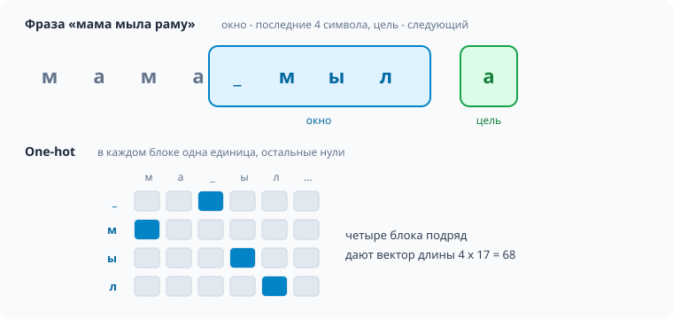
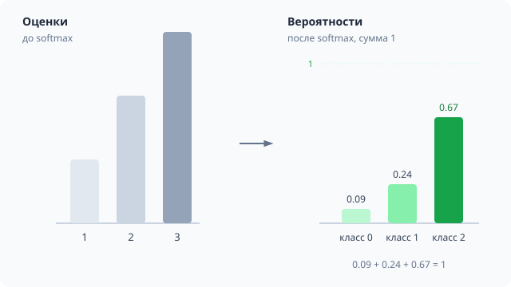
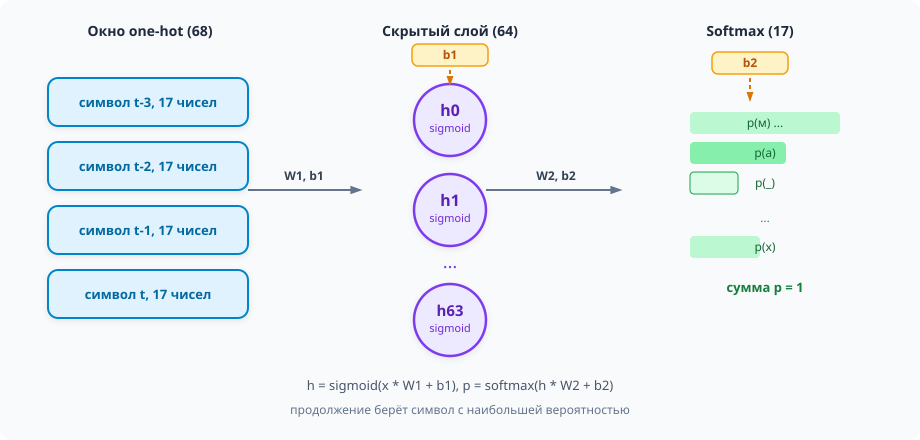
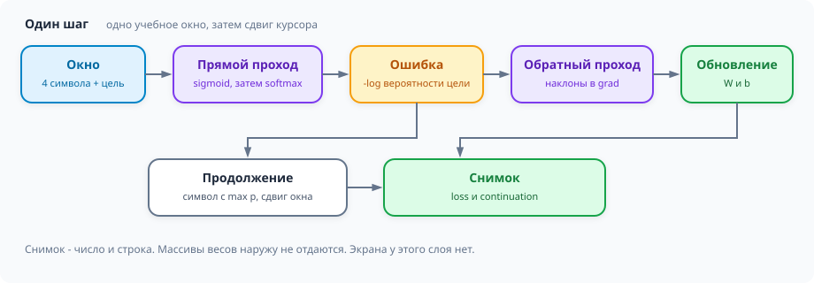

# src/core/lm

Учебная символьная модель: короткий фиксированный текст, следующий символ, softmax. Правила: [../AGENTS.md](../AGENTS.md) (идентификаторы EN, JSDoc и комментарии RU). Тензор берётся из [`src/core/tensor`](../tensor/tensor.ts). Этот пакет не импортирует `src/core/nn`.

## Концепция

### Определения

**Алфавит** — символы корпуса в порядке первого появления, включая перевод строки. В текущем тексте их **17**. Номер символа — столбец softmax.

**Окно** — последние **4** символа перед предсказываемым. Из фразы «мама мыла раму» окно ` мыл` (пробел, «м», «ы», «л») учится предсказывать «а».



**One-hot** — блок из 17 чисел: у верного символа 1, у остальных 0. Четыре блока склеиваются в вектор длины **68**. Короткий контекст дополняется нулями слева. В коде: `oneHot` в [`model.ts`](model.ts).

**Вес и смещение** — те же обучаемые числа, что у XOR. Здесь две матрицы: **W₁** `68×64`, **b₁** `1×64`, **W₂** `64×17`, **b₂** `1×17`. Всего **5521** число. Поля `w1`, `b1`, `w2`, `b2`.

**Sigmoid** — активация скрытого слоя, `σ(x) = 1 / (1 + e^(−x))`. График тот же, что у XOR: [sigmoid.svg](../nn/sigmoid.svg). В коде: [`tensor.ts`, `sigmoid`](../tensor/tensor.ts).

**Softmax** — выход по алфавиту. Из строки оценок `u` получаются положительные вероятности с суммой 1. Перед `exp` из оценки вычитается максимум строки, чтобы большие числа не переполняли `exp`:

`p_c = exp(u_c − max u) / Σ_k exp(u_k − max u)`

На картинке учебная строка оценок `1, 2, 3`. У модели та же операция на 17 символах.



**Target** — следующий символ фразы. Сеть не подглядывает в него на прямом проходе. Он нужен только ошибке: столбец `classIndex` в [`crossEntropy`](../tensor/tensor.ts).

**Кросс-энтропия** — ошибка одного окна: `L = −log(p_цели)`. Если вероятность верного символа растёт, `L` падает. Ноль был бы у вероятности 1.

**Loss** — одно число. `trainStep` возвращает `L` одного окна до обновления весов. `loss()` — среднее `L` по всем **30** учебным окнам, без шага по весам.

**Продолжение** — жадный хвост: на каждом шаге символ с наибольшей вероятностью, окно сдвигается на него. Знакомое начало фразы после обучения дописывается текстом корпуса. Незнакомое начало идёт тем же шагом и состоит из символов алфавита.

**Снимок** — `{ loss, continuation }`. `loss` — ошибка последнего `trainStep` (до первого шага это среднее `loss()`). Массивов весов в снимке нет.

### Задача

Сеть заучивает три фразы из [`corpus.ts`](corpus.ts) и продолжает их по символам. Фразы разделены переводом строки и при каждом `readCorpus()` одинаковы:

```
мама мыла раму
папа спал дома
кот сидел тихо
```

Окна нарезаются внутри фразы, начиная с 4-го символа. В каждой фразе 14 символов и 10 окон, всего 30. Перевод строки входит в алфавит, но целью окна не бывает: окна не переходят через границу фразы.

### Схема 68 → 64 → 17

| Слой    | Размер | Смысл                                                    |
| ------- | ------ | -------------------------------------------------------- |
| Вход    | 68     | Склейка one-hot четырёх символов, без своих весов        |
| Скрытый | 64     | `z = x·W₁ + b₁`, затем sigmoid                           |
| Выход   | 17     | `u = h·W₂ + b₂`, затем softmax. Продолжение берёт argmax |



### Где что живёт в идее

- **Текст** — константа `readCorpus`.
- **Сеть и шаг** — `CharModel`: окна, веса, `trainStep`, `continue`, `snapshot`.
- **Числа и градиенты** — `Tensor` в `src/core/tensor`.

### Начальные веса

`CharModel.create(seed)` заполняет веса генератором от целого seed. Каждое число лежит в `(−1, 1)` и умножается на **0.15**, чтобы sigmoid на старте не залипала у 0 или 1. Один seed даёт одну и ту же сеть.

### Цикл одного шага

Один `trainStep` берёт **одно** следующее окно по кругу из 30 и делает четыре этапа. Скорость `η = 0.8`.



#### 1. Forward

`probabilities` в [`model.ts`](model.ts):

`h = sigmoid(x · W₁ + b₁)`

`p = softmax(h · W₂ + b₂)`

`x` — строка `1×68`. `h` — строка `1×64`. `p` — строка `1×17`.

#### 2. Loss

Для одного окна `L = −log(p_цели)`. Это [`crossEntropy`](../tensor/tensor.ts) по номеру символа. `loss()` усредняет то же выражение по 30 окнам и веса не меняет.

#### 3. Backward

`zeroGrad`, затем `loss.backward()`. Наклон по оценке символа `c`:

`∂L/∂u_c = p_c − 1`, если `c` — цель, иначе `∂L/∂u_c = p_c`.

Дальше цепочка идёт через `W₂` в скрытый слой. У sigmoid множитель тот же, что в XOR: `h·(1−h)`, см. [разбор в README nn](../nn/README.md). В коде шаги записаны в `backwardFn` у `softmax`, `crossEntropy` и `sigmoid`.

#### 4. Update

`applyGrad(0.8)` на `w1`, `b1`, `w2`, `b2`:

`data[i] -= 0.8 · grad[i]`

Курсор окна сдвигается на 1. После 30 шагов круг начинается снова.

### Продолжение и снимок

`continue(prefix, count)` берёт последние 4 символа текущего контекста, выбирает символ с максимальным `p` и дописывает его. Веса при этом не меняются.

`snapshot(prefix, count)` возвращает последнее число ошибки и ту же строку продолжения.

## Концепция → код

| Идея                                 | Где смотреть                                |
| ------------------------------------ | ------------------------------------------- |
| Три фразы                            | [`corpus.ts`](corpus.ts) — `readCorpus`     |
| Создать сеть от seed                 | [`model.ts`](model.ts) — `CharModel.create` |
| Окно one-hot                         | [`model.ts`](model.ts) — `oneHot`           |
| Прямой проход                        | [`model.ts`](model.ts) — `probabilities`    |
| Один шаг                             | [`model.ts`](model.ts) — `trainStep`        |
| Средняя ошибка без шага              | [`model.ts`](model.ts) — `loss`             |
| Жадный хвост                         | [`model.ts`](model.ts) — `continue`         |
| Снимок `{ loss, continuation }`      | [`model.ts`](model.ts) — `snapshot`         |
| Sigmoid, softmax, кросс-энтропия     | [`tensor.ts`](../tensor/tensor.ts)          |
| Заучивание фразы и незнакомое начало | [`lm.test.ts`](lm.test.ts)                  |
| Публичный импорт                     | [`index.ts`](index.ts)                      |

Экрана у слоя нет. Вызывающий код читает снимок.

## Файлы (кратко)

| Файл          | Одна строка                    |
| ------------- | ------------------------------ |
| `corpus.ts`   | фиксированный текст            |
| `model.ts`    | сеть, шаг, продолжение, снимок |
| `lm.test.ts`  | TDD-проверки                   |
| `index.ts`    | экспорт                        |
| `window.svg`  | окно и one-hot                 |
| `net.svg`     | схема 68 → 64 → 17             |
| `softmax.svg` | оценки и вероятности           |
| `flow.svg`    | шаг и снимок                   |

Проверка: `npx vitest run src/core/lm`. Полный каркас: `npm run verify` из корня репозитория.
