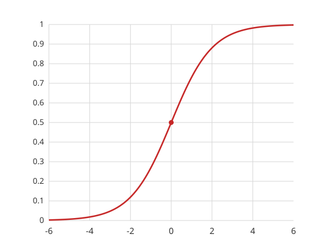
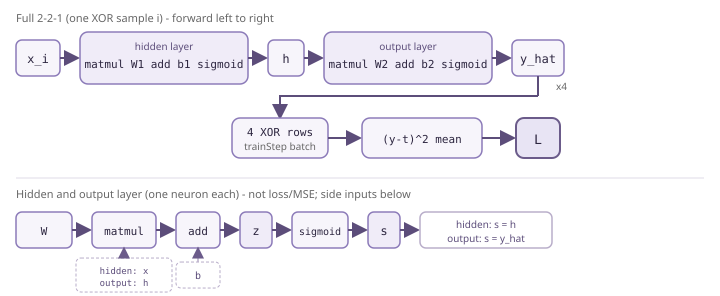
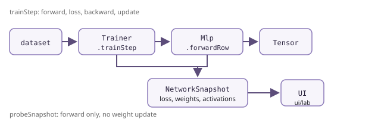

# src/core/nn

Учебное ядро XOR: MLP **2→2→1**, свой autograd. Правила: [../AGENTS.md](../AGENTS.md) (идентификаторы EN, JSDoc и комментарии RU).

## Концепция

### Определения

**Вес** — число на **связи** между нейронами: насколько силён сигнал с предыдущего узла. В коде это элементы матриц **W₁**, **W₂** (`mlp.w1`, `mlp.w2`). При forward вход умножается на веса; при обучении веса **меняются**, чтобы ошибка падала.

**Смещение (bias)** — отдельное обучаемое число **у нейрона**, прибавляется к сумме входов **до** sigmoid. Позволяет сдвинуть решение, даже если все входы нули. В коде: **b₁** (два числа для скрытого слоя), **b₂** (одно на выходе). Обновляется так же, как веса: `старое − скорость × градиент`.

**Sigmoid** — функция активации σ(x) = 1 / (1 + e^(−x)). Сжимает любую сумму в **отрезок от 0 до 1** — «насколько нейрон включён». В центре: при x = 0 выход **0.5**. Без нелинейности XOR одной прямой не выучить. В коде: `tensor.sigmoid()` после каждого слоя в `forwardRow`; на графе в кружках скрытого и выходного слоя — **после** sigmoid (в `activations`).

**Активация** — значение нейрона **после** sigmoid (или сырой бит на входном слое). В снимке UI — поле `activations`: `input` без sigmoid, `hidden` и `output` — после. Одна строка в таблице «Веса по рёбрам» = одна стрелка на графе, не «активация» целого слоя.

**Target (эталон, «верный ответ»)** — для каждой строки XOR: какой **класс должна** выдать сеть (0 или 1). Сеть **не подглядывает** в target на forward; target нужен только в **loss**, чтобы сравнить предсказание **ŷ** с правдой и посчитать ошибку. В коде: поле `target` в [`dataset.ts`](dataset.ts) (`XorSample`), в формуле — `samples[i].target` в [`mseLoss`](mlp.ts). На графе в UI подпись «Цель XOR».

**Loss (ошибка)** — одно число **L**: **средняя** квадратичная ошибка (MSE) по всем четырём строкам XOR. По **каждой** строке сначала считают вклад `(ŷ − target)²`, потом **L** = среднее этих четырёх слагаемых. Меньше — лучше; по **L** график в лаборатории и сигнал для backward. В коде: тензор из `mseLoss`, на экране — `NetworkSnapshot.loss`.

### Задача

Нейросеть должна выучить **XOR**: по двум битам на входе выдать ответ 0 или 1. Правила в код **не зашиты** — только четыре эталонные пары в датасете и цикл обучения.

### Схема 2→2→1

| Слой    | Размер | Смысл                                                                             |
| ------- | ------ | --------------------------------------------------------------------------------- |
| Вход    | 2      | Два бита `(x₁, x₂)` — просто числа 0/1, без своих обучаемых весов                 |
| Скрытый | 2      | Два нейрона: сумма входов × **W₁** + **b₁**, затем **sigmoid**                    |
| Выход   | 1      | Один нейрон: сумма скрытых × **W₂** + **b₂**, затем **sigmoid** → число от 0 до 1 |

**2→2→1** — это **сколько узлов на слое**, не «два веса». Всего **9 обучаемых чисел**: матрицы W₁ (2×2), W₂ (2×1) и смещения b₁ (2), b₂ (1).

### Где что живёт в идее

- **Архитектура и веса** — «тело» сети (`Mlp`).
- **Каждое число (вес, смещение, промежуточный результат)** — **тензор**: в `data` значение, в `grad` — направление для уменьшения ошибки после backward.
- **Обучение** — отдельный цикл (`Trainer`): сравнить с эталоном, посчитать ошибку, обновить `data` у весов.

### Начальные веса

Веса при создании сети — **псевдослучайные**, но **воспроизводимые** (`seed`, в UI — 42). С нуля XOR **не решается**.

### Цикл одного шага («Шаг» в лаборатории)

На **каждом** шаге обучения прогоняются **все четыре** точки XOR. Затем **один** общий loss и **одно** обновление весов. Оркестрация: [`trainer.ts`, `trainStep`](trainer.ts) (комментарии 1–4).

Ниже — **упрощённые формулы**; в коде то же самое через матрицы и autograd.

#### 1. Forward

Для одной пары входа `(x₀, x₁)` (код: [`mlp.ts`, `forwardRow`](mlp.ts)):

**Скрытый слой** (два нейрона, индекс `j ∈ {0,1}`):

- сумма до активации: `zⱼ = x₀·W₁[0,j] + x₁·W₁[1,j] + b₁[j]`
- активация: `hⱼ = σ(zⱼ)` — сигмоида, см. [`tensor.ts`, `sigmoid`](tensor.ts)

**Выход** (один нейрон):

- `z_out = h₀·W₂[0,0] + h₁·W₂[1,0] + b₂[0]`
- предсказание: `ŷ = σ(z_out)` — число 0…1 на графе в кружке выхода

В коде слои записаны как `x.matmul(w1).add(b1)` и `hidden.matmul(w2).add(b2)` — то же, что формулы выше. Реализация умножения: [`tensor.ts`, `matmul`](tensor.ts), сложение со смещением: [`add`](tensor.ts).

#### 2. Loss

По **одной** строке XOR: квадрат промаха `(ŷ − target)²` (тот же, что "станция" в таблице ниже). По всем четырём строкам — **среднее** → **L** (MSE — Mean Squared Error, среднеквадратичная ошибка):

`L = (1/4) · Σ (ŷᵢ − targetᵢ)²`

Код: [`mlp.ts`, `mseLoss`](mlp.ts) — `diff`, квадрат, деление на `N=4`.

#### 3. Backward (градиенты)

**Зачем:** в `p.grad` у каждого из 9 чисел (`W₁`, `b₁`, `W₂`, `b₂`) после backward лежит **`∂L/∂p`** — наклон `L` по этому параметру; его использует SGD (шаг 4).

Реализация получения ∂L/∂(входы) из ∂L/∂(выход этой операции) — `backwardFn` операций в [`tensor.ts`](tensor.ts):

- **sigmoid.** На выход `s` уже пришёл `∂L/∂s`. На сумму `z` нужен `∂L/∂z = ∂L/∂s · ∂s/∂z`. Производная sigmoid — это `s·(1−s)`:

  `∂s/∂z = e^{−z} / (1 + e^{−z})² = s·(1−s)`

  Второе равенство потому, что `s = 1 / (1 + e^{−z})`, а `1 − s = e^{−z} / (1 + e^{−z})`. В коде в градиент входа добавляется `out.grad[i] * s * (1 - s)` ([`tensor.ts`, `sigmoid`](tensor.ts)). Множитель наибольший при `s = 0.5` (равен **0.25**) и почти 0, когда нейрон уже у 0 или у 1: там сдвиг `z` почти не меняет `s` и почти не меняет `L`.

- **add.** Оба слагаемых получают тот же градиент, что пришёл на сумму. Поэтому в **b** копируется `∂L/∂z`.
- **mul.** Каждый множитель домножается на значение другого: для `y = x·w` вклад в `∂L/∂w` содержит `x`.
- **matmul.** То же «домножить на вторую матрицу», только по индексам строки и столбца.

Старт в коде. К этому шагу тензор **L** уже собран: `mseLoss` после forward по четырём строкам. Дальше в [`trainer.ts`, `trainStep`](trainer.ts): `zeroGrad()` на `w1`, `b1`, `w2`, `b2` (градиент копится через `+=`, остаток прошлого шага стирают), затем `loss.backward()`. Внутри `backward()` на скаляр **L** ставится `∂L/∂L = 1`: backward спрашивает, насколько изменится **L**, если чуть сдвинуть сам **L**. Сдвиг на `ε` меняет **L** ровно на `ε`, наклон равен 1 — это производная `f(x) = x`. В коде это `grad[0] = 1` у скаляра loss. Дальше цепное правило домножает эту единицу на локальные производные каждого шага, волна идёт от **L** к родителям операций, и в `p.grad` оказывается `∂L/∂p`. Тот же вход без сети: [`autograd.test.ts`](autograd.test.ts) вызывает `backward()` на `y = x·w + b`, то есть там **L = y**, поэтому `∂L/∂w = x`.

#### 4. Update (SGD)

**SGD** — stochastic gradient descent, стохастический градиентный спуск: каждое обучаемое число сдвигается против своего градиента. Для **каждого** элемента каждого параметра (и вес, и bias):

`новое = старое − η · grad`  (η — скорость обучения, у нас **0.5**, `DEFAULT_LR` в [`trainer.ts`](trainer.ts))

Код: [`tensor.ts`, `applyGrad`](tensor.ts); вызывается на `w1`, `b1`, `w2`, `b2` в `trainStep`.

### Станции на маршруте

Сводка шагов 1–4. Удобно думать об **остановках**: на forward поезд едет слева направо, на backward — с конца к началу. В **hidden layer** и **output layer** — одинаковый **набор операций** (**matmul → add → sigmoid**), но разные веса и входы; станции **loss** (квадрат, среднее, **L**) — только после всей сети, см. верх схемы. Четыре **ŷ** на шаге сходятся в **MSE**.

**Сверху:** целая сеть на одном примере XOR — **hidden layer** и **output layer** (у каждого свои блоки **W₁/b₁** и **W₂/b₂**), затем сведение **четырёх** примеров в **L** (MSE). Это маршрут со **всеми** станциями, включая ошибку.

**Снизу:** не повтор loss и не «ещё один полный путь», а **два слоя крупным планом** на схеме **одного нейрона** (операции **matmul → add → z → sigmoid → s**). Один и тот же **тип** шагов, но **два разных слоя**:

| Слой на схеме    | Параметры в коде | Боковой вход в `matmul`     | После sigmoid (`s`)                |
| ---------------- | ---------------- | --------------------------- | ---------------------------------- |
| **Hidden layer** | `w1`, `b1`       | **x** (биты XOR)            | **h** → идёт в output layer сверху |
| **Output layer** | `w2`, `b2`       | **h** (оба скрытых нейрона) | **ŷ** → дальше MSE **сверху**      |

Пунктиром снизу: **x** только у hidden, **h** только у output; **b** — смещение своего слоя. Backward: те же операции в обратном порядке; **вход в backward** — узел **L** (верх схемы).

**`z`** — сумма **до** sigmoid (раздел Forward). **`s = σ(z)`** — после sigmoid: на скрытом слое это **h**, на выходе **s = ŷ**.

| Станция (forward →) | Математика                                                 | В коде                               |
| ------------------- | ---------------------------------------------------------- | ------------------------------------ |
| Параметры           | Обучаемые числа `W`, `b` (не операция, «склад»)            | `w1`, `b1`, `w2`, `b2`               |
| matmul              | Линейная комбинация: `X @ W`                               | [`matmul`](tensor.ts) в `forwardRow` |
| add                 | Смещение: `z = … + b`                                      | [`add`](tensor.ts)                   |
| sigmoid             | `s = 1 / (1 + e^{−z})`                                     | [`sigmoid`](tensor.ts)               |
| ŷ                   | Предсказание **после** последней sigmoid (одна строка)     | `forwardRow` → `output`              |
| (ŷ − target)²       | **Ошибка по одной строке XOR** (квадрат промаха)           | `mseLoss`: `diff`, квадрат           |
| Среднее → **L**     | **Loss:** среднее по 4 строкам, `(1/4) Σᵢ (ŷᵢ − targetᵢ)²` | `mseLoss`, деление на `N`            |

**Backward (←)** на той же остановке: уже известен **`∂L/∂(выход станции)`**, считаем **`∂L/∂(входы)`** и едем дальше назад. Вопрос на каждой операции:

«У меня уже есть **∂L/∂(выход этой операции)**; как получить **∂L/∂(входы)**?»

| Станция (от **L** назад) | Уже есть на выходе                 | Пишем на вход                                                                                                                     |
| ------------------------ | ---------------------------------- | --------------------------------------------------------------------------------------------------------------------------------- |
| Скаляр **L**             | Старт backward, вызова ещё не было | На сам **L**: `∂L/∂L = 1`. Это делает `loss.backward()` ([`tensor.ts`](tensor.ts), вызов из `trainStep`)                          |
| Среднее, деление на 4    | `∂L/∂L = 1`                        | На квадрат каждой строки XOR: `1/4`                                                                                               |
| `(ŷ − target)²`          | Градиент этого квадрата            | На **ŷ**: пришедшее · `2(ŷ − target)`. **target** не обучается, градиент туда не идёт                                             |
| sigmoid                  | `∂L/∂s`                            | На сумму **z** (вход sigmoid): пришедшее · `s(1−s)`                                                                               |
| add                      | `∂L/∂z`                            | На **b** и на результат matmul: тот же `∂L/∂z`. Сдвиг любого слагаемого так же двигает сумму                                      |
| matmul                   | Градиент результата `X @ W`        | На веса **W**: градиент нейрона × вход с другого конца связи. На вход **X** — тем же приёмом, чтобы волна пошла в предыдущий слой |
| Параметры **W**, **b**   | Волна дошла                        | В `p.grad` уже полный `∂L/∂p`. Шаг 4 вычитает `η·p.grad`                                                                          |

Множитель `1/4` со среднего и `2(ŷ − target)` с квадрата вместе дают `∂L/∂ŷ = (ŷ − target) / 2`.

**Вес и bias:** один `loss.backward()`, один `applyGrad` для всех параметров. Числа в `grad` разные: вес обновляется по правилу **matmul**, bias — по **add** (градиент = градиент на **z**).

---

Граф в UI после обучения показывает **один** выбранный вход ([`probeSnapshot`](trainer.ts)); обучение всегда по **всему** датасету.

## Концепция → код

| Идея                                    | Где смотреть                                                                          |
| --------------------------------------- | ------------------------------------------------------------------------------------- |
| Эталон XOR (4 строки)                   | [`dataset.ts`](dataset.ts) — `XOR_DATASET`                                            |
| Создать сеть 2→2→1, веса W₁…b₂          | [`mlp.ts`](mlp.ts) — `Mlp.xorMlp`, поля `w1`…`b2`                                     |
| Один forward (демо / граф)              | [`mlp.ts`](mlp.ts) — `forwardRow`                                                     |
| Список обучаемых тензоров               | [`mlp.ts`](mlp.ts) — `parameters`                                                     |
| Ошибка по batch                         | [`mlp.ts`](mlp.ts) — `mseLoss`                                                        |
| Снимок для экрана (числа, не Tensor)    | [`mlp.ts`](mlp.ts) — `snapshot`; тип [`snapshot.ts`](snapshot.ts) — `NetworkSnapshot` |
| Цикл Forward → Loss → Backward → Update | [`trainer.ts`](trainer.ts) — `trainStep` (комментарии 1–4 внутри)                     |
| Граф для выбранного входа, без обучения | [`trainer.ts`](trainer.ts) — `probeSnapshot`                                          |
| Матрицы, sigmoid, autograd              | [`tensor.ts`](tensor.ts) — `from`, `matmul`, `sigmoid`, `backward`, `applyGrad`       |
| Мини-пример backward без MLP            | [`autograd.test.ts`](autograd.test.ts)                                                |
| Критерий «XOR выучен»                   | [`xor.test.ts`](xor.test.ts)                                                          |
| Публичный импорт                        | [`index.ts`](index.ts)                                                                |

**UI** ([`src/ui/lab`](../../ui/lab)): кнопка «Шаг» → `trainStep`; радио входа → `probeSnapshot`. Математики в React нет.

Сверху — цепочка обучения; **NetworkSnapshot** собирается из loss, весов и активаций; **UI** только рисует. Подпись внизу схемы: `probeSnapshot` — forward для графа без update.

## Файлы (кратко)

| Файл          | Одна строка                |
| ------------- | -------------------------- |
| `dataset.ts`  | эталон                     |
| `mlp.ts`      | сеть + forward + loss      |
| `trainer.ts`  | обучение + probe для графа |
| `tensor.ts`   | числа и градиенты          |
| `snapshot.ts` | тип снимка                 |
| `*.test.ts`   | TDD-проверки               |
| `index.ts`    | экспорт                    |

Проверка: `npm test`, полный каркас: `npm run verify` из корня репозитория.
