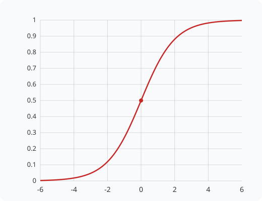
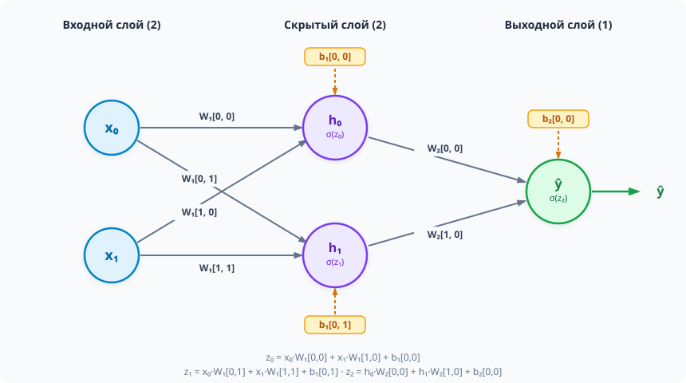
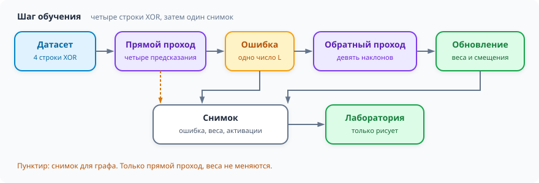

# src/core/nn

Учебное ядро XOR: MLP **2→2→1**, свой autograd. Правила: [../AGENTS.md](../AGENTS.md) (идентификаторы EN, JSDoc и комментарии RU).

## Концепция

### Определения

**Вес** — число на **связи** между нейронами: насколько силён сигнал с предыдущего узла. В коде это элементы матриц **W₁**, **W₂** (`mlp.w1`, `mlp.w2`). При forward вход умножается на веса; при обучении веса **меняются**, чтобы ошибка падала.

**Смещение (bias)** — отдельное обучаемое число **у нейрона**, прибавляется к сумме входов **до** sigmoid. Позволяет сдвинуть решение, даже если все входы нули. В коде: **b₁** (два числа для скрытого слоя), **b₂** (одно на выходе). Обновляется так же, как веса: `старое − скорость × градиент`.

**Sigmoid** — функция активации `σ(x) = 1 / (1 + e⁻ˣ)`. Сжимает любую сумму в интервал **между 0 и 1**, не достигая концов — «насколько нейрон включён». В центре: при x = 0 выход **0.5**. Без нелинейности XOR одной прямой не выучить. В коде: `tensor.sigmoid()` после каждого слоя в `forwardRow`; на графе в кружках скрытого и выходного слоя — **после** sigmoid (в `activations`).

**Активация** — значение нейрона **после** sigmoid (или сырой бит на входном слое). В снимке UI — поле `activations`: `input` без sigmoid, `hidden` и `output` — после. Одна строка в таблице «Веса по рёбрам» = одна стрелка на графе, не «активация» целого слоя.

**Target (эталон, «верный ответ»)** — для каждой строки XOR: какой **класс должна** выдать сеть (0 или 1). Сеть **не подглядывает** в target на forward; target нужен только в **loss**, чтобы сравнить предсказание **ŷ** с правдой и посчитать ошибку. В коде: поле `target` в [`dataset.ts`](dataset.ts) (`XorSample`), в формуле — `samples[i].target` в [`mseLoss`](mlp.ts). На графе в UI подпись «Цель XOR».

**Loss (ошибка)** — одно число **L**: **средняя** квадратичная ошибка (MSE) по всем четырём строкам XOR. По **каждой** строке сначала считают вклад `(ŷ − target)²`, потом **L** = среднее этих четырёх слагаемых. Меньше — лучше; по **L** график в лаборатории и сигнал для backward. В коде: тензор из `mseLoss`, на экране — `NetworkSnapshot.loss`.

### Задача

Нейросеть должна выучить **XOR**: по двум битам на входе выдать ответ 0 или 1. Правила в код **не зашиты** — только четыре эталонные пары в датасете и цикл обучения.

### Схема 2→2→1

| Слой    | Размер | Смысл                                                                                      |
| ------- | ------ | ------------------------------------------------------------------------------------------ |
| Вход    | 2      | Два бита `(x₀, x₁)` — просто числа 0/1, без своих обучаемых весов                          |
| Скрытый | 2      | Два нейрона: сумма входов × **W₁** + **b₁**, затем **sigmoid**                             |
| Выход   | 1      | Один нейрон: сумма скрытых × **W₂** + **b₂**, затем **sigmoid** → число строго между 0 и 1 |

**2→2→1** — это **сколько узлов на слое**, не «два веса». Всего **9 обучаемых чисел**: матрицы W₁ (2×2), W₂ (2×1) и смещения b₁ (2), b₂ (1).

### Где что живёт в идее

- **Архитектура и веса** — «тело» сети (`Mlp`).
- **Каждое число (вес, смещение, промежуточный результат)** — **тензор**: в `data` значение, в `grad` — направление для уменьшения ошибки после backward.
- **Обучение** — отдельный цикл (`Trainer`): сравнить с эталоном, посчитать ошибку, обновить `data` у весов.

### Начальные веса

Нейросеть не способна решить задачу XOR при инициализации весов нулями из-за **проблемы симметрии**: идентичные градиенты превращают скрытые нейроны в неработающие клоны — на каждом шаге обучения они вычисляют одинаковые значения и обновляются абсолютно синхронно.

Чтобы разрушить симметрию и позволить нейронам обучиться разным признакам, начальные веса задаются **псевдослучайным** образом из небольшого диапазона, а фиксация параметра `seed` (в UI — `42`) обеспечивает полную **воспроизводимость** результатов обучения.

### Цикл одного шага («Шаг» в лаборатории)

На **каждом** шаге обучения прогоняются **все четыре** точки XOR. Затем **один** общий loss и **одно** обновление весов. Оркестрация: [`trainer.ts`, `trainStep`](trainer.ts) (комментарии 1–4).

Ниже — **упрощённые формулы**; в коде то же самое через матрицы и autograd.

Один шаг лаборатории — это замкнутый цикл обучения из четырёх этапов. По одним только весам сеть не знает, куда их сдвигать, поэтому этапы идут подряд. **Forward** по текущим весам получает предсказание `ŷ`. **Loss** сравнивает `ŷ` с эталоном и собирает одну ошибку **L**. **Backward** по этой ошибке считает девять наклонов: как **L** изменится, если сдвинуть каждый вес и каждое смещение. **Update** сдвигает эти девять чисел против наклона. Новые веса становятся текущими: следующий шаг снова начинается с **Forward** и проходит тот же круг. Без обновления круг не замыкается, и предсказания повторяются.

#### 1. Forward

Главная цель прямого прохода (forward pass) — вычислить предсказание модели `ŷ` на основе входных данных.

[`forwardRow`](mlp.ts) считает **одну** пару `(x₀, x₁)`. Четыре точки XOR прогоняет `trainStep`, это абзац выше. Внутри одного прохода вычисления идут слева направо: скрытый слой, затем выход.

**Скрытый слой** (два нейрона, индекс `j ∈ {0,1}`).

Сумма до активации вычисляется по формуле `zⱼ = x₀·W₁[0,j] + x₁·W₁[1,j] + b₁[0,j]`, где

- `W₁[0,j]` — вес связи от входа `x₀` к нейрону `j`;
- `W₁[1,j]` — вес связи от входа `x₁` к нейрону `j`;
- `b₁[0,j]` — смещение нейрона `j`. В тензоре `b1` это строка `1×2`: единственная строка `0`, столбец `j`.

Активация каждого нейрона считается по формуле: `hⱼ = σ(zⱼ)` — сигмоида, см. [`tensor.ts`, `sigmoid`](tensor.ts)

**Выход** (один нейрон):

Сумма до активации вычисляется по формуле `z₂ = h₀·W₂[0,0] + h₁·W₂[1,0] + b₂[0,0]`, где

- `W₂[0,0]` — вес связи от первого скрытого нейрона `h₀` к единственному выходному нейрону;
- `W₂[1,0]` — вес связи от второго скрытого нейрона `h₁` к тому же выходному нейрону;
- `b₂[0,0]` — смещение выходного нейрона. В тензоре `b2` это матрица `1×1`, единственный элемент.

Предсказание высчитывается по формуле `ŷ = σ(z₂)`. Сигмоида даёт число строго между 0 и 1.

В коде слои записаны как `x.matmul(w1).add(b1)` и `hidden.matmul(w2).add(b2)` — то же, что формулы выше. Реализация умножения: [`tensor.ts`, `matmul`](tensor.ts), сложение со смещением: [`add`](tensor.ts).

#### 2. Loss

После прямого прохода forward нужно вычислить число, насколько предсказание промахнулось мимо эталона. [`mseLoss`](mlp.ts) считает его по **четырём** строкам XOR, не по одной.

Для строки `i` промах — разница `ŷᵢ − targetᵢ`. Её возводят в квадрат, чтобы минус не компенсировал плюс: `(ŷᵢ − targetᵢ)²`. В коде это `diff`, затем `diff.mul(diff)`.

**L** — среднее этих четырёх квадратов (MSE, mean squared error) вычисляется по формуле `L = (1/4) · Σᵢ (ŷᵢ − targetᵢ)²`.

В коде сумма копится в `total`, затем умножается на `1 / samples.length`. При четырёх строках XOR это и есть `1/4`.

#### 3. Backward (градиенты)

Главная цель обратного прохода (backward pass) — для каждого обучаемого параметра найти, насколько изменится ошибка **L**, если этот параметр чуть сдвинуть. По своему математическому определению частная производная `∂L/∂w` — это и есть точная мера чувствительности функции **L** к бесконечно малому сдвигу одного конкретного параметра `w`, когда все остальные параметры зафиксированы.

После forward девять чисел уже известны. Backward не подставляет вместо них новые значения: он находит девять наклонов. Сам сдвиг веса делает следующий этап, Update.

Считаются девять наклонов:

- `∂L/∂W₁[0,0]`, `∂L/∂W₁[0,1]`, `∂L/∂W₁[1,0]`, `∂L/∂W₁[1,1]` — по четырём весам скрытого слоя;
- `∂L/∂b₁[0,0]`, `∂L/∂b₁[0,1]` — по двум смещениям скрытого слоя;
- `∂L/∂W₂[0,0]`, `∂L/∂W₂[1,0]` — по двум весам выхода;
- `∂L/∂b₂[0,0]` — по смещению выхода.

Плюс значит, что при увеличении параметра **L** растёт, минус — что падает. В коде эти девять чисел ложатся в `grad` тензоров `w1`, `b1`, `w2`, `b2`. Входы `x₀`, `x₁` и эталон `target` в этот список не входят: их не подбирают.

Чтобы рассчитать девять наклонов, мы движемся по сети в обратном порядке — от выходного нейрона к входному слою — и по цепному правилу последовательно вычисляем частные производные.

Цепное правило (дифференцирование сложной функции) говорит, что наклон **L** по весу равен произведению наклонов по всей цепочке от **L** до этого веса (частная производная конечной функции по входному параметру равна произведению частных производных всех промежуточных функций в цепочке вычислений). Для цепочки `L(ŷ(z(W)))`:

`∂L/∂W = ∂L/∂ŷ · ∂y/∂z · ∂z/∂W`

- `∂L/∂ŷ` — насколько изменится ошибка, если сдвинуть выход `ŷ`;
- `∂y/∂z` — насколько изменится выход, если сдвинуть сумму `z` до активации (производная sigmoid);
- `∂z/∂W` — насколько изменится сумма `z`, если сдвинуть вес `W`.

**L** выше — это не квадрат одной точки, а среднее четырёх:

`L = (1/4) · Σᵢ (ŷᵢ − targetᵢ)²`, индекс `i` пробегает четыре точки XOR.

Наклоны ищутся по этой формуле, потому что от весов зависит **L**, а не отдельный квадрат. Считать приходится с конца: вес входит в `z`, `z` входит в `ŷ`, `ŷ` входит в **L**. Пока нет `∂L/∂ŷᵢ`, нет и `∂L/∂W`.

**3.1. Частная производная L по ŷₖ.** `k` — индекс предсказания: одно из `ŷ₀`, `ŷ₁`, `ŷ₂`, `ŷ₃`. В сумме четыре слагаемых. От выбранного `ŷₖ` зависит только слагаемое с тем же индексом, остальные три для этой производной — константы, их производная 0.

`∂L/∂ŷₖ = (1/4) · ∂/∂ŷₖ (ŷₖ − targetₖ)²`

Производная квадрата: `∂/∂ŷₖ (ŷₖ − targetₖ)² = 2(ŷₖ − targetₖ)`. Поэтому

`∂L/∂ŷₖ = (1/4) · 2(ŷₖ − targetₖ) = (ŷₖ − targetₖ) / 2`

`targetₖ` — эталон при том же индексе, что и `ŷₖ`: для `k = 2` это верный ответ строки `(1, 0) → 1`. Его берут из датасета и на протяжении всего обучения не меняют, поэтому в производной по `ŷₖ` эталон стоит как константа. Ищут, как изменится **L**, если сдвинуть предсказание.

В [`mseLoss`](mlp.ts) эталон создаётся так: `Tensor.from([[samples[i].target]], { requiresGrad: false })`. Число из датасета в вычитание попадает: для строки `(1, 0)` это `ŷ − 1`. Флаг `requiresGrad: false` означает, что у этого тензора нет массива `grad`.

Дальше индекс `k` в записи опущен: `∂L/∂ŷ` значит наклон **L** по одному выбранному предсказанию, а не по всем четырём сразу. Вклады четырёх предсказаний складываются в конце, когда те же шаги повторяют для `k = 0, 1, 2, 3`.

**3.2. От ŷ к z₂.** В forward предсказание — сигмоида от суммы до активации: `ŷ = σ(z₂)`, где `σ(z) = 1 / (1 + e⁻ᶻ)`. На шаге 1 уже есть `∂L/∂ŷ`. Сумма `z₂` влияет на **L** только через `ŷ`, поэтому

`∂L/∂z₂ = ∂L/∂ŷ · ∂ŷ/∂z₂`

Остаётся производная самой сигмоиды. Дифференцирование `1 / (1 + e⁻ᶻ)` по `z` даёт

`dσ/dz = e⁻ᶻ / (1 + e⁻ᶻ)²`

Исходное определение, оно же предсказание на выходе: `ŷ = σ(z₂) = 1 / (1 + e⁻ᶻ₂)`. Дальше `z` в выкладке — это `z₂`.

**3.2.а.** Дробь производной делится на произведение двух множителей. Одна скобка знаменателя выносится вперёд:

`e⁻ᶻ / (1 + e⁻ᶻ)² = 1 / (1 + e⁻ᶻ) · e⁻ᶻ / (1 + e⁻ᶻ)`

Первый множитель — это уже `ŷ`.

**3.2.б.** Второй множитель преобразуется так, чтобы убрать `e⁻ᶻ` из числителя. В числителе прибавляется и вычитается единица:

`e⁻ᶻ / (1 + e⁻ᶻ) = ((1 + e⁻ᶻ) − 1) / (1 + e⁻ᶻ)`

Числитель делится на знаменатель почленно:

`(1 + e⁻ᶻ) / (1 + e⁻ᶻ) − 1 / (1 + e⁻ᶻ) = 1 − 1 / (1 + e⁻ᶻ) = 1 − ŷ`

**3.2.в.** Оба множителя собираются обратно:

`1 / (1 + e⁻ᶻ) · (1 − 1 / (1 + e⁻ᶻ)) = ŷ(1−ŷ)`

Значит `∂ŷ/∂z₂ = ŷ(1−ŷ)`. Подстановка в цепное правило:

`∂L/∂z₂ = ∂L/∂ŷ · ŷ(1−ŷ)`

В коде тот же множитель в `sigmoid`: к градиенту входа добавляется `out.grad[i] * s * (1 - s)` ([`tensor.ts`](tensor.ts)). На выходе `s` равно `ŷ`.

**3.3. Выходные параметры.** Определяем градиенты выходного слоя `∂L/∂W₂[0,0]`, `∂L/∂W₂[1,0]`, `∂L/∂b₂[0,0]`. **L** не содержит `W₂` и `b₂` напрямую. Они входят в **L** только потому, что входят в `z₂`, а `z₂` входит в `ŷ`. По цепному правилу `∂L/∂p = ∂L/∂z₂ · ∂z₂/∂p` для любого параметра `p`, где `p` — это `W₂[0,0]`, `W₂[1,0]` или `b₂[0,0]`.

Вспомним формулу суммы `z₂ = h₀·W₂[0,0] + h₁·W₂[1,0] + b₂[0,0]`.

Теперь берём частную производную `z₂` по каждому из трёх параметров (все остальные слагаемые считаются константами и при дифференцировании превращаются в 0).

Производная `b₂[0,0]` по самому себе равна 1:

`∂z₂/∂b₂[0,0] = 1`.

Производная по `W₂[0,0]` равна `h₀`:

`∂z₂/∂W₂[0,0] = h₀`.

Производная по `W₂[1,0]` равна `h₁`:

`∂z₂/∂W₂[1,0] = h₁`.

Итого после подстановки в цепное правило все три параметра:

- `∂L/∂W₂[0,0] = ∂L/∂z₂ · h₀` — для первого веса `W₂[0,0]`;
- `∂L/∂W₂[1,0] = ∂L/∂z₂ · h₁` — для второго веса `W₂[1,0]`;
- `∂L/∂b₂[0,0] = ∂L/∂z₂` — для смещения `b₂[0,0]`.

**3.4. От hⱼ к zⱼ** (`j ∈ {0,1}`). Сначала нужен `∂L/∂hⱼ`. `h₀` и `h₁` входят в ту же сумму `z₂ = h₀·W₂[0,0] + h₁·W₂[1,0] + b₂[0,0]`.

Производная по `h₀` равна `W₂[0,0]`:

`∂z₂/∂h₀ = W₂[0,0]`.

Производная по `h₁` равна `W₂[1,0]`:

`∂z₂/∂h₁ = W₂[1,0]`.

Подстановка в цепное правило:

- `∂L/∂h₀ = ∂L/∂z₂ · W₂[0,0]` — наклон **L** по `h₀`;
- `∂L/∂h₁ = ∂L/∂z₂ · W₂[1,0]` — наклон **L** по `h₁`.

Дальше внутри скрытого нейрона `hⱼ = σ(zⱼ)`. Повторяя расчёт шага 2, получаем

`∂L/∂zⱼ = ∂L/∂hⱼ · hⱼ(1−hⱼ)`

**3.5. Параметры скрытого слоя.** Определяем шесть градиентов скрытого слоя: `∂L/∂W₁[0,0]`, `∂L/∂W₁[0,1]`, `∂L/∂W₁[1,0]`, `∂L/∂W₁[1,1]`, `∂L/∂b₁[0,0]`, `∂L/∂b₁[0,1]`. Ниже они записаны через индекс `j`: `∂L/∂W₁[0,j]`, `∂L/∂W₁[1,j]`, `∂L/∂b₁[0,j]`.

Вспомним формулу суммы скрытого слоя `zⱼ = x₀·W₁[0,j] + x₁·W₁[1,j] + b₁[0,j]` и повторим вычисления из шага 3:

- `∂L/∂W₁[0,j] = ∂L/∂zⱼ · x₀` — для весов `W₁[0,0]` и `W₁[0,1]`;
- `∂L/∂W₁[1,j] = ∂L/∂zⱼ · x₁` — для весов `W₁[1,0]` и `W₁[1,1]`;
- `∂L/∂b₁[0,j] = ∂L/∂zⱼ` — для смещений `b₁[0,0]` и `b₁[0,1]`.

`x₀` и `x₁` дальше не дифференцируются.

Так получается вклад одной точки. `trainStep` повторяет шаги 1–5 для всех четырёх точек и складывает вклады в одни и те же девять чисел. В коде это `loss.backward()` после `zeroGrad()` на `w1`, `b1`, `w2`, `b2`.

#### 4. Update (SGD)

Главная цель этапа обновления (update) — сдвинуть каждый из девяти обучаемых параметров так, чтобы ошибка **L** уменьшилась. К этому моменту сами параметры известны с forward, а девять наклонов `∂L/∂p` уже лежат в `grad` после backward. Новое значение параметра здесь подставляется впервые.

**SGD** (stochastic gradient descent, стохастический градиентный спуск) для одного параметра `p`. Буква `p` здесь — любое из девяти обучаемых чисел: вес `W₁`, `W₂` или смещение `b₁`, `b₂`. Например, `p = W₂[0,0]` или `p = b₁[0,1]`.

`p_новое = p_старое − η · ∂L/∂p`

`η` — скорость обучения. В [`trainer.ts`](trainer.ts) это `DEFAULT_LR`, число **0.5**. Минус стоит потому, что наклон показывает, куда **L** растёт. Шаг в обратную сторону этот рост уменьшает. Если `∂L/∂p` положительный, параметр становится меньше. Если отрицательный — больше.

Та же формула для всех девяти чисел:

- `W₁[0,0]`, `W₁[0,1]`, `W₁[1,0]`, `W₁[1,1]` вычитают `η · ∂L/∂W₁[…]`;
- `b₁[0,0]`, `b₁[0,1]` вычитают `η · ∂L/∂b₁[0,j]`;
- `W₂[0,0]`, `W₂[1,0]` вычитают `η · ∂L/∂W₂[…]`;
- `b₂[0,0]` вычитает `η · ∂L/∂b₂[0,0]`.

В коде это [`tensor.ts`, `applyGrad`](tensor.ts): `data[i] -= learningRate * grad[i]`. [`trainStep`](trainer.ts) вызывает `applyGrad` на `w1`, `b1`, `w2`, `b2` после `loss.backward()`.

## Концепция → код

| Идея                                    | Где смотреть                                                                          |
| --------------------------------------- | ------------------------------------------------------------------------------------- |
| Эталон XOR (4 строки)                   | [`dataset.ts`](dataset.ts) — `XOR_DATASET`                                            |
| Создать сеть 2→2→1, веса W₁…b₂          | [`mlp.ts`](mlp.ts) — `Mlp.xorMlp`, поля `w1`…`b2`                                     |
| Один forward (демо / граф)              | [`mlp.ts`](mlp.ts) — `forwardRow`                                                     |
| Список обучаемых тензоров               | [`mlp.ts`](mlp.ts) — `parameters`                                                     |
| Ошибка по batch                         | [`mlp.ts`](mlp.ts) — `mseLoss`                                                        |
| Снимок для экрана (числа, не Tensor)    | [`mlp.ts`](mlp.ts) — `snapshot`; тип [`snapshot.ts`](snapshot.ts) — `NetworkSnapshot` |
| Цикл Forward → Loss → Backward → Update | [`trainer.ts`](trainer.ts) — `trainStep` (комментарии 1–4 внутри)                     |
| Граф для выбранного входа, без обучения | [`trainer.ts`](trainer.ts) — `probeSnapshot`                                          |
| Матрицы, sigmoid, autograd              | [`tensor.ts`](tensor.ts) — `from`, `matmul`, `sigmoid`, `backward`, `applyGrad`       |
| Мини-пример backward без MLP            | [`autograd.test.ts`](autograd.test.ts)                                                |
| Критерий «XOR выучен»                   | [`xor.test.ts`](xor.test.ts)                                                          |
| Публичный импорт                        | [`index.ts`](index.ts)                                                                |

**UI** ([`src/ui/lab`](../../ui/lab)): кнопка «Шаг» → `trainStep`; радио входа → `probeSnapshot`. Математики в React нет.

Сверху — цепочка обучения; **NetworkSnapshot** собирается из loss, весов и активаций; **UI** только рисует. Подпись внизу схемы: `probeSnapshot` — forward для графа без update.

## Файлы (кратко)

| Файл          | Одна строка                |
| ------------- | -------------------------- |
| `dataset.ts`  | эталон                     |
| `mlp.ts`      | сеть + forward + loss      |
| `trainer.ts`  | обучение + probe для графа |
| `tensor.ts`   | числа и градиенты          |
| `snapshot.ts` | тип снимка                 |
| `*.test.ts`   | TDD-проверки               |
| `index.ts`    | экспорт                    |

Проверка: `npm test`, полный каркас: `npm run verify` из корня репозитория.
